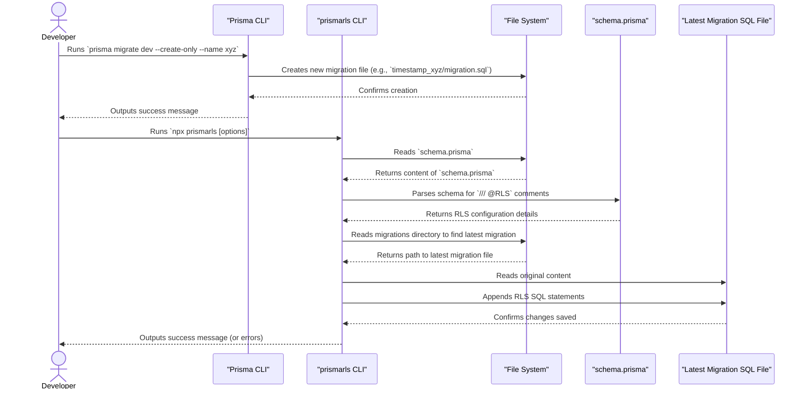

# Technical Information for Prismarls Contributors

This document provides technical details about the `prismarls` tool, its architecture, and guidelines for contributors.

## Project Overview

### Purpose of `prismarls`

`prismarls` is a command-line interface (CLI) tool designed to streamline the integration of PostgreSQL's Row-Level Security (RLS) with Prisma migrations. Manually adding RLS policies to every migration can be error-prone and tedious. `prismarls` automates this process by appending the necessary RLS-related SQL statements directly to the migration files generated by Prisma. This ensures that your RLS setup is version-controlled and applied consistently as part of your database migration strategy.

### Interaction with Prisma and PostgreSQL RLS

The typical workflow involving `prismarls` is as follows:

1.  A developer defines their database schema using `schema.prisma`. To indicate that a table or specific columns should have RLS policies applied, they add a special comment: `/// @RLS`.
2.  The developer then creates a new migration file using the Prisma command: `npx prisma migrate dev --create-only --name <migration_name>`. This command generates a new SQL migration file but does not apply it to the database.
3.  Next, the developer runs `prismarls` with appropriate options (e.g., specifying the path to `schema.prisma` and the migrations directory).
4.  `prismarls` parses the `schema.prisma` file to find all tables and columns marked with `/// @RLS`.
5.  It then identifies the most recently created migration file in the specified migrations directory.
6.  Finally, `prismarls` appends the SQL commands required to:
    *   Enable RLS on the designated tables.
    *   Create default isolation policies (e.g., based on `current_setting('app.tenant_id')`).
    *   Create policies to bypass RLS (e.g., based on `current_setting('app.bypass_rls')`).

This process ensures that RLS configurations are automatically included in your migration scripts, making it easier to manage and deploy secure database schemas.

## Architecture Details

`prismarls` is a Node.js CLI tool written in TypeScript. Its main components and workflow are described below.

### Main Components

1.  **CLI Argument Parser (`src/cli.ts`)**:
    *   Uses a library (e.g., `yargs` or a similar one, though currently it seems to be custom parsing of `process.argv`) to define and parse command-line arguments like `--schema`, `--migrations`, `--currentSettingIsolation`, etc.
    *   Validates the provided arguments.
2.  **Schema Parser ( leveraging `@loancrate/prisma-schema-parser`)**:
    *   Reads the `schema.prisma` file.
    *   Parses the Prisma schema syntax to identify models (tables) and fields (columns).
    *   Specifically looks for `/// @RLS` comments on models and fields to determine which entities require RLS policies.
3.  **Migration File Processor**:
    *   Identifies the latest migration file in the directory specified by the `--migrations` argument. This usually involves reading the directory contents and finding the file with the most recent timestamp in its name.
    *   Reads the content of the latest migration file.
    *   Constructs the SQL statements for enabling RLS and creating the necessary policies based on the parsed schema information and command-line options.
    *   Appends these SQL statements to the end of the migration file.

### Workflow Diagram

The following diagram illustrates the typical workflow when using `prismarls`:



This flow allows developers to augment their standard Prisma migration process with automated RLS policy generation.

## Development Setup

To contribute to `prismarls`, you'll need to set up a local development environment.

### Prerequisites

*   **Node.js**: Version 18 or higher (as specified in `package.json`). You can use a version manager like `nvm` to manage Node.js versions.
*   **npm**: Comes bundled with Node.js. Used for package management.
*   **Git**: For cloning the repository and managing versions.

### Setup Steps

1.  **Clone the Repository**:
    ```bash
    git clone https://github.com/shoito/prismarls.git
    cd prismarls
    ```

2.  **Install Dependencies**:
    Install the project dependencies using npm:
    ```bash
    npm install
    ```
    This will install packages listed in `package.json`, including `typescript`, `prisma`, and other development tools.

3.  **Build the Project**:
    `prismarls` is written in TypeScript. You need to compile it to JavaScript to run it:
    ```bash
    npm run build
    ```
    This command runs `tsc` (the TypeScript compiler), which compiles the source files from `src/` into `dist/`.

4.  **Running Locally for Development**:

    *   **Using `npm run dev`**:
        The easiest way to run the tool with your local changes is using the `dev` script, which utilizes `ts-node` to run TypeScript directly:
        ```bash
        npm run dev -- --schema=./examples/prisma/schema.prisma --migrations=./examples/prisma/migrations --currentSettingIsolation=app.company_id
        ```
        You can modify the arguments as needed, similar to how you would run the published `prismarls` command.

    *   **Using `npm link`**:
        If you want to test `prismarls` globally like the installed version, you can use `npm link`:
        1.  First, build the project: `npm run build`
        2.  Then, link it: `npm link`
        3.  Now you can run `prismarls` directly in your terminal from any directory (it will use your local code):
            ```bash
            prismarls --schema=./examples/prisma/schema.prisma --migrations=./examples/prisma/migrations --currentSettingIsolation=app.company_id
            ```
        To unlink, run `npm unlink @shoito/prismarls` in the project directory, or `npm unlink prismarls` if you linked it without scope.

### Example Project

The `examples/` directory contains a sample Prisma project (`examples/prisma/schema.prisma`) and migrations that you can use for testing your changes. The scripts in `package.json` (like `rls:append:dev`) are configured to use this example project.

## Contribution Guidelines

We welcome contributions to `prismarls`! Please follow these guidelines to help us maintain the quality and consistency of the project.

### Coding Standards

*   **Formatting**: This project uses Biome for code formatting. Before committing your changes, please run the formatter:
    ```bash
    npm run format
    ```
    This will automatically format the code in the `src/` directory.
*   **Linting**: We also use Biome for linting to catch potential errors and enforce code style. Run the linter with:
    ```bash
    npm run lint
    ```
    This command will check for issues and attempt to apply fixes where possible. Please ensure your code passes the lint checks before submitting a pull request.

### Testing Your Changes

Currently, `prismarls` does not have a dedicated automated test suite. However, it's crucial to manually test your changes thoroughly:

1.  **Use the Example Project**: The `examples/` directory is provided for testing.
    *   You can modify `examples/prisma/schema.prisma` to test different schema configurations.
    *   Generate new migrations using `npm run migrate:dev` (which uses `prisma migrate dev --create-only`).
    *   Apply your locally modified `prismarls` tool using `npm run rls:append:dev` (or via `npm link` as described in Development Setup).
2.  **Verify Generated SQL**: After running `prismarls`, inspect the generated SQL in the latest migration file within `examples/prisma/migrations/`. Ensure that the SQL is correct and achieves the intended RLS setup.
3.  **Test Migrations (Optional but Recommended)**: If you have PostgreSQL set up, you can try applying the migrations to a test database using `npx prisma migrate deploy --schema=./examples/prisma/schema.prisma` to ensure they run without errors.

### Submitting Changes

1.  **Fork the Repository**: Create a fork of the `shoito/prismarls` repository on GitHub.
2.  **Create a New Branch**: Create a descriptive branch for your changes (e.g., `feat/add-new-policy-type` or `fix/improve-schema-parsing`).
    ```bash
    git checkout -b your-branch-name
    ```
3.  **Make Your Changes**: Implement your feature or bug fix. Remember to adhere to coding standards and test your changes.
4.  **Commit Your Changes**: Write clear and concise commit messages.
    ```bash
    git commit -m "feat: Add support for XYZ feature"
    ```
5.  **Push to Your Fork**:
    ```bash
    git push origin your-branch-name
    ```
6.  **Create a Pull Request**: Open a pull request from your forked repository's branch to the `main` branch of `shoito/prismarls`.
    *   Provide a clear description of the changes you've made and why.
    *   If your PR addresses an existing issue, please link to it.

We'll review your pull request as soon as possible. Thank you for contributing!
